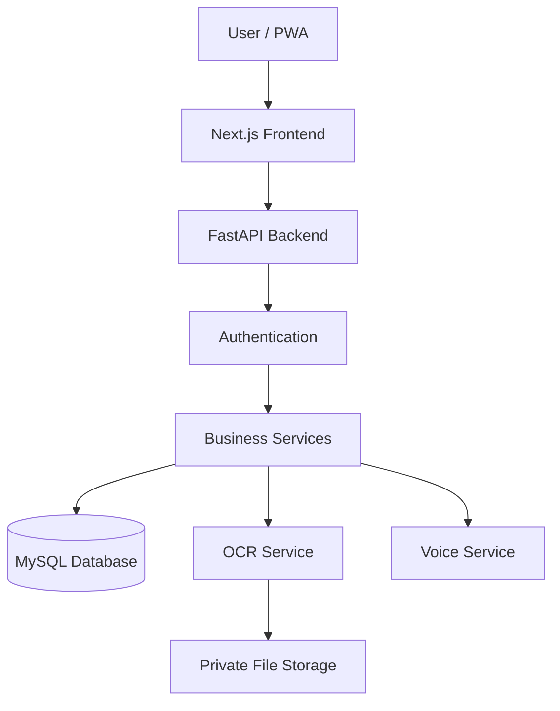

# SYSTEM ARCHITECTURE

## 1. Teknologi

**Frontend:**
* Next.js
* React
* TypeScript
* Tailwind CSS

**Backend:**
* FastAPI
* Python
* Pydantic
* SQLAlchemy

**Database:**
* MySQL 8
* Alembic

**OCR:**
* PaddleOCR atau solusi open-source sejenis.

**Voice:**
* Web Speech API sebagai implementasi awal.

## 2. Arsitektur Sistem

## 3. Backend Architecture

Backend menggunakan pemisahan tanggung jawab (*separation of concerns*):

* **API Layer:** menerima *request*.
* **Schema Layer:** validasi data.
* **Service Layer:** *business logic*.
* **Repository Layer:** *query database*.
* **Model Layer:** struktur tabel.
* **Core Layer:** konfigurasi dan *security*.

## 4. Family Finance

Satu pengguna dapat memiliki:
* Personal Finance.
* Family Group A.
* Family Group B.
* Family Group lainnya.

> **Catatan:** Relasi pengguna dan grup menggunakan tabel `group_members`. Setiap grup memiliki satu *Shared Ledger* (buku catatan bersama).

## 5. Transaction Scope

**Personal:**
* `owner_user_id` terisi.
* `group_id` NULL.

**Group:**
* `owner_user_id` NULL.
* `group_id` terisi.

> `created_by_user_id` selalu menunjukkan pengguna yang membuat transaksi, terlepas dari apakah itu transaksi personal maupun grup.

## 6. Keamanan

* Authentication wajib.
* Authorization dilakukan di *backend*.
* Validasi *membership* (keanggotaan) pada setiap akses grup.
* File *receipt* (struk) bersifat privat.
* Kode undangan disimpan dalam bentuk *hash*.
* *Secret* disimpan melalui *environment variables*.

## 7. Deployment

**Development:**
* Next.js lokal.
* FastAPI lokal.
* MySQL lokal.

**Production:**
* Frontend deployment.
* Backend deployment.
* MySQL server.
* HTTPS.
* Private file storage.